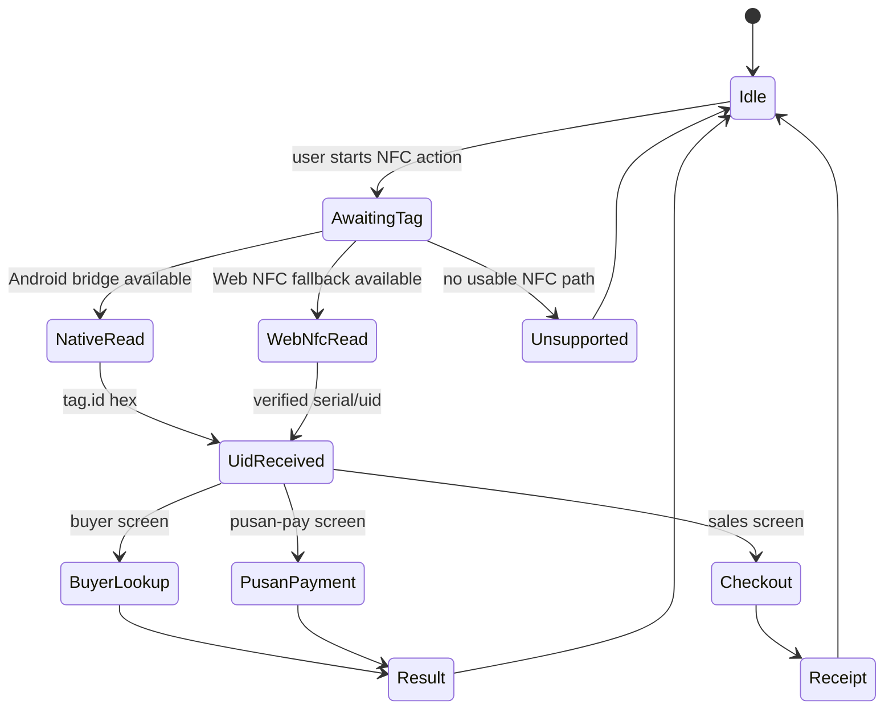

# PUSAN MART PWA + NFC Rebuild Plan

Date: 2026-07-29

This document captures the brownfield analysis for rebuilding the current Android Kotlin/Jetpack Compose POS app as a PWA-oriented system with Android phone NFC tag input. It uses BMAD as the planning frame and a LangGraph-style state model for NFC-driven workflows.

## Executive Decision

Build a PWA frontend backed by a secure API, and keep Android NFC as a native bridge for production checkout.

Pure Web NFC should only be treated as an optional fallback because POS checkout depends on exact card UID matching against `person.uid`, `bank.uid`, and `PusanmartPayments.nfcid`. The existing native Android app reliably reads `Tag.id` as a hex UID, while Web NFC support is browser-limited and NDEF-focused.

## Current System Map

| Area | Current file | Current behavior | PWA target |
|---|---|---|---|
| App shell/navigation | `app/src/main/java/com/smeag/mobilemart/MainActivity.kt` | Compose bottom tabs and shared NFC event | PWA app shell with route-based navigation |
| Shared state | `app/src/main/java/com/smeag/mobilemart/AppViewModel.kt` | Products, cart, checkout, buyer lookup, reports | Client state store plus API service layer |
| Database | `app/src/main/java/com/smeag/mobilemart/data/DbRepository.kt` | Direct MariaDB JDBC from device | Server API owns DB access and transactions |
| NFC reader | `app/src/main/java/com/smeag/mobilemart/nfc/NfcHelper.kt` | Android foreground dispatch reads tag UID | Capacitor/custom Android bridge dispatches UID to PWA |
| Sales checkout | `ui/screens/SalesScreen.kt` | Cart plus NFC card tap completes sale | `/sales` route with bridged NFC checkout |
| Buyer lookup | `ui/screens/BuyerScreen.kt` | NFC card tap queries `person` | `/buyer` route with bridged NFC lookup |
| PusanMart payment | `ui/screens/PusanmartPaymentScreen.kt` | Manual amount plus NFC card tap logs payment | `/pusan-pay` route with bridged NFC payment |
| Products | `RegisterScreen.kt`, `ModifyScreen.kt` | CRUD plus photo upload | `/products/new`, `/products/:id/edit` |
| Reports/history | `HistoryScreen.kt`, `ReportScreen.kt`, `PayListScreen.kt` | Date filters, PDF/XLSX export | `/history`, `/reports`, `/pusan-payments` |

## BMAD Brownfield Framing

### Business

- Preserve fast cashier workflow: product selection, discount, NFC tap, receipt.
- Preserve PusanMart total-amount flow: amount, discount, NFC tap, payment log.
- Preserve manager/admin campus filtering and report workflows.
- Improve deployability by making the main app installable from the browser.

### Model

- Keep existing table contracts initially: `mgperson`, `person`, `store_menus`, `bank`, `PusanmartPayments`.
- Normalize client API models around the current Kotlin models: manager, person, product, cart item, transaction, report, PusanMart payment.
- Keep UID canonicalization compatible with the current app: lowercase hex string from Android `Tag.id`.

### Architecture

- PWA frontend: React/Vite or Next.js app, service worker, manifest, offline shell, HTTPS.
- Backend API: Node/Fastify, NestJS, Hono, or similar. It must own MariaDB credentials, SFTP/storage credentials, auth, and checkout transactions.
- Android NFC wrapper: Capacitor plugin or custom Kotlin WebView bridge. It reads NFC with Android APIs and emits a browser event to the PWA.
- Optional Web NFC fallback: only for Android Chrome devices where `NDEFReader` works and UID/serial is verified against real cards.

### Delivery

- Phase 1: API extraction and parity contracts.
- Phase 2: PWA shell and login/products/sales parity.
- Phase 3: Android NFC bridge and real-device UID validation.
- Phase 4: reports, exports, photo upload, and optional photo matching migration.
- Phase 5: hardening: HTTPS, secrets rotation, audit logs, role-based access, offline UX.

## PWA Routes

| Route | Purpose |
|---|---|
| `/login` | Manager/admin login |
| `/sales` | Product grid, cart, discounts, NFC checkout |
| `/sales/receipt` | Completed checkout receipt |
| `/products/new` | Product registration and photo upload |
| `/products/:id/edit` | Stock/minimum/price/product updates |
| `/history` | Bank transaction history |
| `/reports` | Weekly report, low stock, top products |
| `/buyer` | NFC buyer lookup |
| `/pusan-pay` | PusanMart amount-only NFC payment |
| `/pusan-payments` | PusanMart payment list/export |

## API Surface

| Method | Path | Purpose |
|---|---|---|
| `POST` | `/api/auth/login` | Authenticate `mgperson` account |
| `GET` | `/api/products?campus=` | List products with campus filter |
| `POST` | `/api/products` | Create product |
| `PATCH` | `/api/products/:id` | Update stock, min stock, price, metadata |
| `DELETE` | `/api/products/:id` | Delete product |
| `GET` | `/api/people/by-nfc/:uid` | Lookup buyer by NFC UID |
| `POST` | `/api/checkouts` | Atomic cart checkout |
| `GET` | `/api/history` | Query `bank` transactions |
| `GET` | `/api/reports/weekly` | Weekly totals, low stock, top products |
| `POST` | `/api/pusanmart/payments` | Insert amount-only NFC payment |
| `GET` | `/api/pusanmart/payments` | List PusanMart payments |
| `POST` | `/api/uploads/product-photo` | Upload product image |

## Checkout Transaction Requirements

The server must preserve the current transaction semantics from `DbRepository.checkout`:

1. Start DB transaction.
2. Lock buyer balance with `SELECT ... FOR UPDATE`.
3. Calculate subtotal, discount, and final total server-side.
4. Reject insufficient balance.
5. Lock each product row before stock update.
6. Reject insufficient stock.
7. Insert one `bank` row per cart line with a shared order id.
8. Update `person.totalmoney`.
9. Commit or roll back as one atomic unit.

The PWA must never calculate final authority values alone. It may display estimates, but the API response is the source of truth.

## LangGraph-Style NFC State Graph



## NFC Bridge Contract

Native Android sends one browser event per successful NFC tap:

```ts
type NfcTagEvent = CustomEvent<{
  uid: string;
  source: "android-native" | "web-nfc";
  timestamp: number;
}>;

window.dispatchEvent(
  new CustomEvent("nfc-tag", {
    detail: {
      uid,
      source: "android-native",
      timestamp: Date.now(),
    },
  }),
);
```

Frontend listener:

```ts
window.addEventListener("nfc-tag", (event) => {
  const { uid } = (event as NfcTagEvent).detail;
  // Route-specific handler: buyer lookup, checkout, or PusanMart payment.
});
```

Android UID normalization must match the existing app:

```kotlin
val uid = tag.id.joinToString("") { "%02x".format(it) }
```

## NFC Implementation Options

| Option | Fit | Notes |
|---|---|---|
| PWA + Capacitor Android plugin | Best production fit | Keeps PWA stack while preserving native NFC UID access |
| PWA + custom Kotlin WebView bridge | Good controlled-device fit | More custom native code, fewer plugin constraints |
| Trusted Web Activity + Web NFC | Limited | Strong PWA install story, weak guaranteed UID bridge |
| Pure browser PWA + Web NFC | Not recommended for POS | Browser/device/tag support too uncertain for payment |

## Frontend Services

- `authService`: login, session restore, logout.
- `productService`: product list, create, update, delete.
- `checkoutService`: cart checkout and receipt data.
- `buyerService`: NFC UID buyer lookup.
- `historyService`: bank transaction queries.
- `reportService`: weekly report data.
- `pusanPaymentService`: amount-only payment insert/list.
- `uploadService`: product image upload.
- `nfcService`: native bridge listener, Web NFC fallback, duplicate tap handling.

## Security and Infrastructure Requirements

- Remove DB and SFTP credentials from all client-side code before deployment.
- Rotate any credentials that have already been embedded in APK/source artifacts.
- Serve the PWA and API over HTTPS.
- Use server-side sessions or signed tokens with role and campus claims.
- Add server-side authorization for manager/admin/store roles.
- Add audit logging for checkout, product mutation, and PusanMart payment creation.
- Avoid storing raw passwords; migrate manager passwords to salted hashes.

## Real Device Test Checklist

- Known card UID matches the old Android app exactly, including byte order and case.
- Same card tapped twice creates two distinct frontend events.
- Sales checkout writes `bank` rows and updates `person.totalmoney` atomically.
- Buyer lookup reads the correct `person.uid`.
- PusanMart payment writes the correct `PusanmartPayments.nfcid`.
- NFC disabled state shows actionable guidance.
- No NFC hardware state shows actionable guidance.
- Unsupported browser falls back to native bridge packaging guidance.
- Web NFC fallback is tested separately from the native bridge.

## Suggested Next Build Step

Create a new `pwa/` app and `api/` service beside the existing Android app. Keep the current Android app untouched as the parity oracle while rebuilding route by route.

Recommended first implementation slice:

1. `api/`: auth, products list, buyer lookup, checkout transaction.
2. `pwa/`: installable shell, login, sales screen, `nfcService` mock/native event listener.
3. `android-bridge/` or Capacitor Android plugin: native NFC UID read and JS event dispatch.

